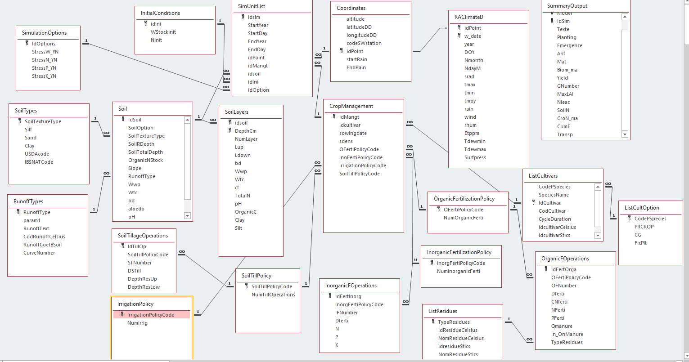

Database Structure
==================

ModFileGen reads two SQLite databases and writes model results back into the
first one:

**MasterInput**
    The model-independent description of the simulations: points and weather,
    soils, initial conditions, crop managements, cultivars, simulation options
    and parameter overrides. It also receives the results
    (``SummaryOutput`` and the daily output tables).

**ModelsDictionary**
    The model metadata: for each model, the parameters of each input file with
    their description, unit, type and default value (table ``Variables``).

The same MasterInput feeds every model (STICS v9 and v11, DSSAT 4.7 and 4.8,
CELSIUS v3 and V32, APSIM). Model-specific values come from ModelsDictionary,
or from the override tables of MasterInput when a soil, a management or a point
needs its own value.

Conventions
-----------

Identifiers
    Text identifiers link the tables (``idsim``, ``idPoint``, ``idsoil``,
    ``idMangt``, ``idIni``). Soil identifiers are matched without case.
    ``idsim`` follows the convention ``<lat>_<lon>_<year>_<management>...``:
    CELSIUS outputs decode the latitude, longitude and year from it.

Dates
    Simulation dates are a year and a day of year (``StartYear``/``StartDay``,
    ``EndYear``/``EndDay``). Management operations are dated in days after
    sowing (negative before sowing, ``0`` on the sowing day).

Policy codes
    Fertilisation, irrigation and tillage are described by a *policy*: a code
    referenced by ``CropManagement`` and a list of dated *operations* sharing
    that code. The code ``0`` means "no operation". Codes may be text, for
    example ``SCN_fert_min``.

Missing values
    ``NULL`` means unknown. A converter then falls back to another source (a
    layer value to the soil value, a measure to a model default) as described
    for each column and in :doc:`configuration`.

Units
    Water contents are volumetric percentages (cm3/100 cm3), depths are in cm,
    concentrations of carbon, nitrogen and particle sizes are in %
    (g/100 g of soil), amounts are per hectare.

Relationships
-------------

.. code-block:: text

    SimUnitList ──idPoint──► Coordinates ──idPoint──► RAclimateD (daily weather)
        │      ├─idsoil───► Soil ──RunoffType──► RunoffTypes
        │      │              └──IdSoil──► SoilLayers
        │      ├─idIni────► InitialConditions ──idIni──► InitialConditionsLayers
        │      ├─idOption─► SimulationOptions
        │      └─idMangt──► CropManagement (one row per season and plant)
        │                     ├─Idcultivar──► ListCultivars ──CodePSpecies──► ListCultOption
        │                     ├─InoFertiPolicyCode──► InorganicFertilizationPolicy / InorganicFOperations
        │                     ├─OFertiPolicyCode────► OrganicFertilizationPolicy / OrganicFOperations
        │                     ├─IrrigationPolicyCode► IrrigationPolicy / IrrigationFOperations
        │                     └─SoilTillPolicyCode──► SoilTillPolicy / SoilTillageOperations
        └─ results ──► SummaryOutput, SticsDailyOutput, SticsProfile, DssatDailyOutput

    Overrides: SoilParameterOverrides (idsoil), CropManagementParameterOverrides
    (idMangt, SeasonOrder, PlantOrder), PointParameterOverrides (idPoint).

Simulation control
------------------

SimUnitList
~~~~~~~~~~~

One row per simulation unit: a point, a soil, a management, initial conditions
and options over a period. A successive simulation (rotation) is one row whose
management has several seasons.

.. list-table::
   :header-rows: 1
   :widths: 20 12 68

   * - Column
     - Type
     - Meaning
   * - ``idsim``
     - text
     - Unique simulation identifier (``<lat>_<lon>_<year>_<management>...``).
   * - ``StartYear``, ``StartDay``
     - integer
     - First simulated day (year, day of year).
   * - ``EndYear``, ``EndDay``
     - integer
     - Last simulated day (year, day of year). The weather of the point must
       cover the whole period, otherwise the simulation is skipped and
       reported (see :doc:`configuration`).
   * - ``idPoint``
     - text
     - Point: ``Coordinates`` and ``RAclimateD``.
   * - ``idMangt``
     - text
     - Crop management: ``CropManagement``.
   * - ``idsoil``
     - text
     - Soil: ``Soil`` and ``SoilLayers``.
   * - ``idIni``
     - text
     - Initial conditions: ``InitialConditions``.
   * - ``idOption``
     - integer
     - Simulation options: ``SimulationOptions.IdOptions``.

SimulationOptions
~~~~~~~~~~~~~~~~~

.. list-table::
   :header-rows: 1
   :widths: 20 12 68

   * - Column
     - Type
     - Meaning
   * - ``IdOptions``
     - integer
     - Option set identifier.
   * - ``StressW_YN``, ``StressN_YN``, ``StressP_YN``, ``StressK_YN``
     - 0/1
     - Activate water, nitrogen, phosphorus and potassium stresses. Used by
       STICS and DSSAT (simulation options) and CELSIUS (``OptionsModel``).

Location and weather
--------------------

Coordinates
~~~~~~~~~~~

.. list-table::
   :header-rows: 1
   :widths: 20 12 68

   * - Column
     - Type / unit
     - Meaning
   * - ``idPoint``
     - text
     - Point identifier.
   * - ``latitudeDD``, ``longitudeDD``
     - decimal degrees
     - Position, written to the model weather and soil files and to the
       output ``lat``/``lon`` columns.
   * - ``altitude``
     - m
     - Elevation.
   * - ``tav``
     - °C
     - Optional annual average temperature. DSSAT weather files use it when
       filled, else the ModelsDictionary default.
   * - ``amp``
     - °C
     - Optional annual amplitude of monthly mean temperature; same rule as
       ``tav``.
   * - ``codeSWstation``, ``startRain``, ``EndRain``
     - text / integer
     - Nearest synoptic station and rainy-season bounds. Not read by the
       converters.

RAclimateD
~~~~~~~~~~

Daily weather of each point, one row per day. A simulation runs only when its
whole period is covered by consecutive days.

.. list-table::
   :header-rows: 1
   :widths: 20 15 65

   * - Column
     - Unit
     - Meaning
   * - ``idPoint``
     - text
     - Point identifier.
   * - ``w_date``
     - ``YYYY-MM-DD``
     - Date.
   * - ``year``, ``DOY``
     - integer
     - Year and day of year.
   * - ``Nmonth``, ``NdayM``
     - integer
     - Month and day of month.
   * - ``srad``
     - MJ/m²/day
     - Global radiation.
   * - ``tmax``, ``tmin``, ``tmoy``
     - °C
     - Maximum, minimum and mean air temperature.
   * - ``rain``
     - mm
     - Rainfall.
   * - ``wind``
     - m/s
     - Wind speed at 2 m.
   * - ``rhum``
     - %
     - Relative humidity.
   * - ``Etppm``
     - mm
     - Penman-Monteith reference evapotranspiration (FAO 56).
   * - ``Tdewmin``, ``Tdewmax``
     - °C
     - Minimum and maximum dew point; DSSAT uses their mean as ``DEWP``.
   * - ``Surfpress``
     - Pa
     - Surface pressure. Not read by the current converters.
   * - ``vapeurp``
     - hPa (mbar)
     - Vapour pressure for STICS; the ModelsDictionary default when missing.
   * - ``co2``
     - ppm
     - Atmospheric CO2 concentration, when available.

Coordinate_years
~~~~~~~~~~~~~~~~

List of the years available for each point (``idPoint``, ``year``). Not read
by the converters.

Soils
-----

Soil
~~~~

One row per soil. A ``simple`` soil is described by this row only; a
``detailed`` soil also has layers in ``SoilLayers``. The ``Soil`` values are
then the fallback of missing layer values.

.. list-table::
   :header-rows: 1
   :widths: 20 15 65

   * - Column
     - Unit
     - Meaning
   * - ``IdSoil``
     - text
     - Soil identifier (matched without case).
   * - ``SoilOption``
     - ``simple`` / ``detailed``
     - Soil description: one layer, or the layers of ``SoilLayers``.
   * - ``SoilTextureType``
     - text
     - Texture class (key of ``SoilTypes``). Also used to re-estimate the
       albedo when ``albedoStrategy = "texture"``.
   * - ``SoilTotalDepth``
     - cm
     - Total soil depth (expected ≥ ``SoilRDepth``).
   * - ``SoilRDepth``
     - cm
     - Maximum rooting depth.
   * - ``Wwp``, ``Wfc``
     - % vol.
     - Water content at wilting point and at field capacity.
   * - ``Ssat``
     - % vol.
     - Optional saturated water content. Missing: derived from ``Wfc``.
   * - ``Ssks``
     - cm/h
     - Optional saturated hydraulic conductivity. Missing: model default
       (DSSAT ``ssks``, APSIM ``KS``).
   * - ``bd``
     - g/cm³
     - Bulk density.
   * - ``cf``
     - % vol.
     - Coarse fragments (stones).
   * - ``clay``, ``silt``, ``sand``
     - %
     - Particle size distribution. ``sand`` and ``clay`` drive the STICS v11
       ``q0`` computation.
   * - ``OrganicC``
     - %
     - Organic carbon content.
   * - ``OrganicNStock``
     - %
     - Organic nitrogen content. ``OrganicC / OrganicNStock`` gives the soil
       C/N ratio.
   * - ``pH``
     - –
     - pH in water.
   * - ``extp``, ``totp``
     - mg/kg
     - Extractable and total phosphorus (DSSAT ``SLPX``, ``SLPT``; ``-99`` =
       not measured).
   * - ``albedo``
     - 0–1
     - Bare soil albedo, or the texture estimate (``albedoStrategy``).
   * - ``RunoffType``
     - text code
     - Runoff behaviour of the bare soil (``RunoffTypes``). Codes are
       compared as text; a number stored by an older database (``2`` or
       ``2.0``) matches ``'2'``.
   * - ``DrainFAO``
     - 1–7
     - Optional FAO drainage class (1 very poorly to 7 excessively drained).
       DSSAT derives ``SLDR`` from it.
   * - ``Slope``
     - %
     - Slope, read by APSIM.
   * - ``location``, ``awcpf``
     - –
     - Not read by the converters.

SoilLayers
~~~~~~~~~~

Layers of a ``detailed`` soil, numbered from 1 at the surface. A missing layer
value falls back to the ``Soil`` value where the converter allows it
(``Ssat``, ``Ssks``, particle sizes for APSIM).

.. list-table::
   :header-rows: 1
   :widths: 20 15 65

   * - Column
     - Unit
     - Meaning
   * - ``idsoil``
     - text
     - Soil identifier.
   * - ``NumLayer``
     - integer
     - Layer number, from 1 at the surface. Also the ``NumLayer`` of layer
       overrides.
   * - ``Lup``, ``Ldown``
     - cm
     - Upper and lower depth of the layer.
   * - ``DepthCm``
     - cm
     - Lower depth of the layer (used by CELSIUS).
   * - ``Wwp``, ``Wfc``, ``Ssat``
     - % vol.
     - Wilting point, field capacity, saturation.
   * - ``Ssks``
     - cm/h
     - Saturated hydraulic conductivity.
   * - ``bd``
     - g/cm³
     - Bulk density.
   * - ``cf``
     - % vol.
     - Coarse fragments.
   * - ``Clay``, ``Silt``
     - %
     - Particle sizes (an optional ``Sand`` column is read by APSIM).
   * - ``OrganicC``
     - %
     - Organic carbon.
   * - ``TotalN``
     - %
     - Total nitrogen (DSSAT ``SLNI``).
   * - ``pH``
     - –
     - pH in water.

SoilTypes
~~~~~~~~~

Texture classes: ``SoilTextureType`` with typical ``Clay``, ``Silt`` and
``Sand`` contents (%), ``USDAcode`` and ``IBSNATCode``.

RunoffTypes
~~~~~~~~~~~

.. list-table::
   :header-rows: 1
   :widths: 25 75

   * - Column
     - Meaning
   * - ``RunoffType``
     - Runoff code referenced by ``Soil.RunoffType``.
   * - ``RunoffText``
     - Description.
   * - ``RunoffCoefBSoil``
     - Runoff fraction of rainfall on bare soil (mm/mm), used by STICS.
   * - ``CurveNumber``
     - USDA curve number, used by DSSAT (``SLRO``).
   * - ``CodRunoffCelsius``
     - CELSIUS V32 runoff code (``Soil.TypeRui``, a row of the CELSIUS
       ``TypeSurfSol`` table), for example ``2`` (moderate runoff) gives
       ``6``. Without this column, ``Soil.RunoffType`` is written as is.
   * - ``param1``
     - Reserved.

Initial conditions
------------------

InitialConditions
~~~~~~~~~~~~~~~~~

.. list-table::
   :header-rows: 1
   :widths: 20 20 60

   * - Column
     - Unit
     - Meaning
   * - ``idIni``
     - text
     - Identifier referenced by ``SimUnitList.idIni``.
   * - ``WStockinit``
     - % of available water
     - Initial water: 0 at wilting point, 100 at field capacity.
   * - ``Ninit``
     - kg N/ha
     - Initial mineral (nitrate) nitrogen of the rootable soil; split between
       layers for a detailed soil.
   * - ``NH4initf``
     - kg N/ha
     - Initial ammonium; the ModelsDictionary default when missing.
   * - ``option``
     - ``simple`` (default), ``detailed``, ``legacy``
     - With ``detailed`` and a detailed soil, STICS v11 reads the layer values
       of ``InitialConditionsLayers``.

InitialConditionsLayers
~~~~~~~~~~~~~~~~~~~~~~~

Initial conditions per layer (``idIni``, ``NumLayer``, ``Lup``, ``Ldown``,
``WStockinit``, ``Ninit``, ``NH4initf``), same units as
``InitialConditions``. Required once ``InitialConditions.option`` exists.

Crop management
---------------

CropManagement
~~~~~~~~~~~~~~

One row per season and per plant of a management. A standard management has
one season; a rotation has seasons 1 to n; an intercrop has several plants in
the same season. ``(idMangt, SeasonOrder, PlantOrder)`` is unique.

.. list-table::
   :header-rows: 1
   :widths: 22 18 60

   * - Column
     - Unit
     - Meaning
   * - ``idMangt``
     - text
     - Management identifier. DSSAT uses its first four characters as station
       and site code.
   * - ``SeasonOrder``
     - integer (default 1)
     - Season number in a rotation.
   * - ``PlantOrder``
     - integer (default 1)
     - Plant number in an intercrop.
   * - ``SeasonYearOffset``
     - years (default 0)
     - Sowing year of the season relative to ``SimUnitList.StartYear``.
       Older databases may name it ``SowingYearOffset``; it is still read.
   * - ``Idcultivar``
     - text
     - Cultivar (``ListCultivars.IdCultivar``).
   * - ``sowingdate``
     - day of year
     - Sowing day.
   * - ``DHarvest``
     - days after sowing
     - Harvest date.
   * - ``sdens``
     - plants/m²
     - Sowing density.
   * - ``InoFertiPolicyCode``, ``OFertiPolicyCode``, ``IrrigationPolicyCode``, ``SoilTillPolicyCode``
     - code
     - Mineral fertilisation, organic fertilisation, irrigation and tillage
       policies (``0`` = none).

Policies and operations
~~~~~~~~~~~~~~~~~~~~~~~

Each policy table lists a code and its number of operations; each operation
table holds the dated operations of a code.

.. list-table::
   :header-rows: 1
   :widths: 30 70

   * - Table
     - Columns
   * - ``InorganicFertilizationPolicy``
     - ``InorgFertiPolicyCode``, ``NumInorganicFerti``.
   * - ``InorganicFOperations``
     - ``idFertInorg``, ``InorgFertiPolicyCode``, ``IFNumber`` (operation
       number), ``Dferti`` (days after sowing), ``N``, ``P``, ``K`` (kg/ha).
   * - ``OrganicFertilizationPolicy``
     - ``OFertiPolicyCode``, ``NumOrganicFerti``.
   * - ``OrganicFOperations``
     - ``idFertOrga``, ``OFertiPolicyCode``, ``OFNumber``, ``Dferti`` (days
       after sowing), ``Qmanure`` (kg dry matter/ha), ``NFerti`` and
       ``PFerti`` (kg/kg of dry matter), ``CNferti`` (C/N ratio),
       ``In_OnManure`` (``in`` incorporated, ``on`` left on the surface as a
       mulch), ``TypeResidues`` (``ListResidues``).
   * - ``IrrigationPolicy``
     - ``IrrigationPolicyCode``, ``NumIrrig``.
   * - ``IrrigationFOperations``
     - ``idIrrigation`` (key), ``IrrigationPolicyCode``,
       ``IrrigationNumber``, ``DIrrigation`` (days after sowing),
       ``IrrigationAmount`` (mm).
   * - ``SoilTillPolicy``
     - ``SoilTillPolicyCode``, ``NumTillOperations``.
   * - ``SoilTillageOperations``
     - ``IdTillOp``, ``SoilTillPolicyCode``, ``STNumber``, ``DSTill`` (days
       after sowing), ``DepthResUp`` and ``DepthResLow`` (cm, depths of
       residue incorporation).

In a rotation (STICS v11), a season starts on its first operation (sowing or
an earlier dated operation) and ends the day before the next season starts.

Crops and residues
------------------

ListCultivars
~~~~~~~~~~~~~

Model-independent cultivars and their code in each model.

.. list-table::
   :header-rows: 1
   :widths: 25 75

   * - Column
     - Meaning
   * - ``IdCultivar``
     - Cultivar identifier referenced by ``CropManagement.Idcultivar``.
   * - ``CodePSpecies``
     - Species code (``ListCultOption``).
   * - ``SpeciesName``
     - Species name.
   * - ``CodCultivar``
     - Cultivar code.
   * - ``idcultivarStics``, ``IdcultivarDssat``, ``IdcultivarCelsius``
     - Cultivar of the model. CELSIUS V32 looks it up in the template
       ``Cultivars`` table.
   * - ``CycleDuration``
     - Not read by the converters.

ListCultOption
~~~~~~~~~~~~~~

DSSAT and STICS settings of each species (``CodePSpecies``):

.. list-table::
   :header-rows: 1
   :widths: 20 80

   * - Column
     - Meaning
   * - ``CG``
     - DSSAT code of the current crop, for example ``MZ``. Used as crop code
       in the experiment file and its extension (``ITSA1301.MZX``).
   * - ``DSCROP``
     - DSSAT crop model, for example ``CER047``. Its version suffix follows
       ``dssat_version`` (``047`` or ``048``). ``CG`` + ``DSCROP`` names the
       model and its cultivar, ecotype and species files, for example
       ``MZCER048.CUL``, ``.ECO`` and ``.SPE`` in ``pltfolder``.
   * - ``PRCROP``
     - DSSAT code of the previous crop, written in the initial conditions of
       the experiment file (``PCR``).
   * - ``FicPlt``
     - STICS plant file.

ListResidues
~~~~~~~~~~~~

Residue and manure types (``TypeResidues``) with their code and name in each
model: ``IdResidueCelsius`` (CELSIUS mulch code), ``idresidueStics``,
``idresidueDssat`` and the matching names.

Parameter overrides
-------------------

Three optional tables replace a ModelsDictionary default for one soil, one
management row or one point. ``Model`` and ``TargetTable`` match the
``model`` and ``Table`` of ``Variables``, ``Parameter`` its ``Champ``, and
``Value`` is stored as text and converted with the parameter type. Names are
matched without case.

.. list-table::
   :header-rows: 1
   :widths: 30 25 45

   * - Table
     - Key
     - Used for
   * - ``SoilParameterOverrides``
     - ``IdSoil``, ``Model``, ``TargetTable``, ``Parameter``, ``NumLayer``
     - STICS v11 ``paramsol``; DSSAT ``dssat_soil_site`` and
       ``dssat_soil_data``; APSIM ``Physical``, ``SoilWater``, ``Organic``,
       ``Chemical``; CELSIUS ``Soil``.
   * - ``CropManagementParameterOverrides``
     - ``idMangt``, ``SeasonOrder``, ``PlantOrder``, ``Model``,
       ``TargetTable``, ``Parameter``
     - STICS v11 ``fictec1`` and ``fictec2``.
   * - ``PointParameterOverrides``
     - ``idPoint``, ``Model``, ``TargetTable``, ``Parameter``
     - STICS v11 ``station``.

``SoilParameterOverrides.NumLayer`` is ``0`` for the whole profile and ``1`` to
``n`` for one layer. The full priority rules are in :doc:`configuration`.

Other tables
------------

``SimulationOptions``
    See `Simulation control`_.

``dailyobs``
    Observations used for calibration (STICS v11 text-to-XML tools):
    ``idsim``, ``maturitydate`` (day counted from the simulation start year,
    ``365 × year offset + day of year``, as STICS encodes multi-year dates)
    and ``maturitydate_calendar`` (calendar date).

``Models``
    List of the models with a display order. Not read by the converters.

Result tables
-------------

The converters create or extend these tables when they write results;
their columns depend on the output configuration (:doc:`output_configuration`).

``SummaryOutput``
    One row per simulation, season and plant: ``Model``, ``IdSim``,
    ``SeasonOrder``, ``PlantOrder``, ``lon``, ``lat``, ``time`` and the selected
    shared variables (dates of phenological stages, biomass, yield, nitrogen,
    water balance...). Each converter replaces only its own model rows.

``SticsDailyOutput``, ``SticsProfile``, ``DssatDailyOutput``
    Daily outputs, written when ``dailyoutput = 1``, limited to the simulation
    period.

ModelsDictionary
----------------

The ``Variables`` table describes every model parameter, one row per model,
input table and parameter.

.. list-table::
   :header-rows: 1
   :widths: 30 70

   * - Column
     - Meaning
   * - ``model``
     - Model: ``stics`` (v9), ``sticsv11``, ``dssat``, ``celsius``, ``Apsim``,
       and ``master`` for the description of MasterInput itself.
   * - ``Table``
     - Model input table or file section (the ``TargetTable`` of overrides).
   * - ``Champ``
     - Parameter name.
   * - ``Description``, ``unit``
     - Meaning and unit.
   * - ``Type``
     - Value type, used to convert defaults and overrides.
   * - ``Default_Value_Datamill``
     - Default value.
   * - ``defaultValueOtherSource``, ``SourceDV``
     - Alternative default and its source; when filled, it replaces
       ``Default_Value_Datamill``.
   * - ``Minnval``, ``Maxval``
     - Valid range.
   * - ``domain``, ``status``, ``commentaire``, ``SuiviModif``
     - Classification, status, comments and change log.
   * - ``TableUsedInACMEYN``, ``TableListYN``, ``defaultvalueYN``, ``ACMEinputEquivalentYN``, ``ACMEinputField``, ``FunctionACME``, ``FileNativeF``
     - Legacy metadata of the ACME/Datamill platform.

Main tables per model:

.. list-table::
   :header-rows: 1
   :widths: 15 85

   * - Model
     - Tables
   * - ``sticsv11``
     - ``paramsol`` (soil), ``ficini`` (initial state), ``fictec1`` and
       ``fictec2`` (management of plants 1 and 2), ``climat``, ``station``,
       ``new_travail`` (run settings), ``st_tempopar*`` (general parameters).
   * - ``stics``
     - The same files for STICS v9, prefixed ``st_`` (``st_param_sol``,
       ``st_fictec``, ``st_ficini``...).
   * - ``dssat``
     - ``dssat_soil_site`` and ``dssat_soil_data`` (soil file), ``dssat_weather_site``
       and ``dssat_weather_data``, ``dssat_cultivar_*``, and the ``dssat_x_*``
       sections of the experiment file.
   * - ``celsius``
     - The CELSIUS tables (``Soil``, ``Soil_layers``, ``Tech_Commun``,
       ``Tech_perCrop``, ``OptionsModel``...).
   * - ``Apsim``
     - ``Aps_*`` tables; APSIM soil overrides use ``Physical``, ``SoilWater``,
       ``Organic`` and ``Chemical``.

Schema history
--------------

Databases created before these changes keep working; the new columns and
tables are optional unless stated.

.. list-table::
   :header-rows: 1
   :widths: 15 85

   * - Date
     - Change
   * - 2026-09
     - ``IrrigationFOperations``; ``SoilParameterOverrides``,
       ``CropManagementParameterOverrides`` and ``PointParameterOverrides``;
       ``Soil.Ssat``.
   * - 2026-10-03
     - ``CropManagement.SowingYearOffset`` renamed ``SeasonYearOffset``;
       ``InitialConditions.option`` and ``NH4initf``;
       ``InitialConditionsLayers``; ``dailyobs``; ``RAclimateD.rhum`` as a
       number, ``vapeurp`` and ``co2``.
   * - 2026-10-08
     - ``SoilLayers.Ssat``.
   * - 2026-10-23
     - ``Coordinates.tav`` and ``amp``; ``SoilParameterOverrides.NumLayer``
       (part of the primary key, ``0`` for existing rows).
   * - 2026-10-24
     - ``Soil.Ssks`` and ``SoilLayers.Ssks``; ``Soil.DrainFAO``.
